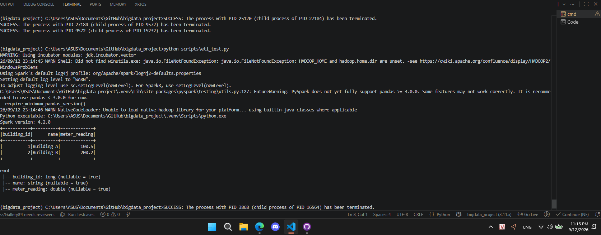

# Demo 

Real-time YouTube comment sentiment analysis using:
* Python
* Apache Kafka
* Apache Spark Structured Streaming
* Spark MLlib / NLP
* MongoDB
* Real-Time Analytics Dashboard

## Setup

### 1. Clone the repository

```bash
git clone https://github.com/giunzz/bigdata_project.git
cd bigdata_project
```

### 2. Install `uv`

If you don't have `uv` installed:

#### Linux / macOS

```bash
curl -LsSf https://astral.sh/uv/install.sh | sh
```

Then restart your terminal or run:

```bash
source ~/.bashrc
```

Check:

```bash
uv --version
```

#### Windows

Open PowerShell:

```powershell
powershell -ExecutionPolicy ByPass -c "irm https://astral.sh/uv/install.ps1 | iex"
```

Then check:

```powershell
uv --version
```

---

### 3. Setup the Python environment

Inside the project directory, simply run:

```bash
uv sync
```


#### Update 
Phase 1
 Read RAW CSV

Phase 2
→ RAW → BRONZE
   ép schema
   timestamp → TimestampType
   kiểm tra null
   ghi Parquet

Phase 3
→ BRONZE → SILVER
   train JOIN building_metadata
   JOIN weather_train
   clean missing values

Phase 4
→ SILVER → GOLD
   feature engineering
   aggregate
   dữ liệu sẵn sàng cho ML / Kafka

RAW
= file gốc chưa đụng vào

BRONZE
= dữ liệu đã được đưa vào hệ thống xử lý
  nhưng vẫn giữ gần nguyên bản nhất có thể

SILVER
= dữ liệu đã clean, join, chuẩn hóa

GOLD
= dữ liệu cuối dùng cho dashboard / ML / analytics